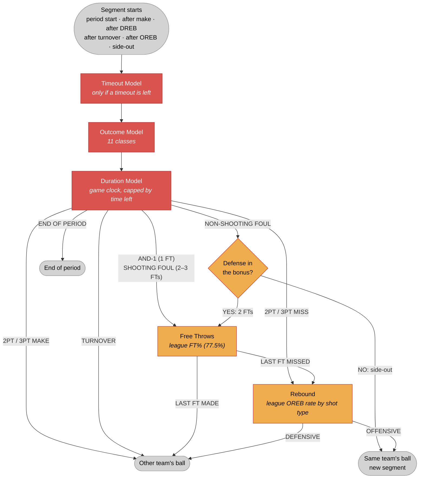

# nbasim

A league-average NBA game simulator at the possession level. A chain of small ML models (the same "ML sub-models + Monte Carlo loop" design as DraftKings' football model) is fit to 2016-17 through 2025-26 play-by-play. Teams and players are not modeled: every team plays like the league average.

## Install

The package lives on the `package` branch of this repo:

```r
install.packages("remotes")   # if needed
remotes::install_github("cballard18/nba-pbp-sim-general@package")
```

Dependencies (`data.table`, `xgboost`) are installed automatically, and the fitted models ship with the package, so nothing else needs downloading.

## Quick start

```r
library(nbasim)

# a game state, from the point of view of the team with the ball (team 1 in all output)
state <- game_state(period = 4, secs_left = 40, off_score = 101, def_score = 103,
                    def_fouls = 5, def_fouls_l2 = 1)

sim_pbp()                                 # play-by-play of a full game from tip-off
sim_pbp(state)                            # finish the game from the state
sim_pbp(state, until = "possession")      # just the next possession

win_prob(state)                           # win probability for the team with the ball
sim_from_state(state, n = 10000)          # final score etc. for 10k simulations
sim_games(1000)                           # 1k full games from tip-off
```

A longer tour: `source(system.file("examples/quickstart.R", package = "nbasim"))`.

| function | what it does |
|---|---|
| `game_state()` | describe a situation: clock, score, how the possession started, fouls, timeouts |
| `sim_pbp()` | play-by-play for one game, a full game or the next possession |
| `sim_games()` | many games from tip-off, one summary row per game |
| `sim_from_state()` | many simulations from a state |
| `win_prob()` | win probability from a state |
| `simulate_games()` | the engine: `new_games()` / `games_from_states()` in, with `until` and `pbp` options |

`pbp` columns: period, clock (after the event), offense (1/2), start_type, timeout, duration, event, fta, ftm, rebound, points, score1, score2.

## How it works

The unit is a **segment**: a team's turn with the ball until a shot, turnover, defensive foul or the end of the period. An offensive rebound or a non-bonus (side-out) foul starts a new segment for the same team. Each loop step simulates one segment for every unfinished game at once:



Red boxes are xgboost models, orange boxes are coded rules and league rates, and grey boxes are where a segment starts or ends. After every segment the score, team fouls, timeouts and clock are updated. A period also ends whenever the clock reaches 0.

1. **Timeout?** xgboost, binary. Only allowed if the team has a timeout left.
2. **Outcome**, xgboost with 11 classes: 2PT/3PT make/miss, 2PT/3PT and-1, shooting foul (2 or 3 FTs), non-shooting foul, turnover, end of period.
3. **Duration** given the outcome: xgboost over game-clock time, capped at the time left in the period. Shot-clock limits are not enforced; the model learns them from the data (game time can run past 24 s, e.g. during an inbound after a make).
4. **Free throws** at the league FT% (77.5%). A non-shooting foul gives 2 FTs when the defense is in the bonus, otherwise a side-out.
5. **Rebound** after a missed FG or a missed final FT, at the league offensive rebound rate by shot type.
6. Update score, team fouls, timeouts and possession, then handle period ends.

The model features are period, seconds left in the period and in the game, score margin, how the segment started, defensive bonus, timeout called, and timeouts left. NBA rules are coded directly: the bonus (verified at 99.6% against the data), timeout limits (7 per game, max 4 in Q4 and 2 after 3:00, 2 per OT), and who starts each period. Close late-game rows get 10× training weight, because they are rare but decide close games.

## Validation (held-out games)

| per game | actual | sim |
|---|---|---|
| total points | 223.2 | 222.5 |
| possessions | 199.6 | 199.6 |
| 3PA / FTA / TOV / OREB | 67.1 / 43.9 / 28.1 / 27.6 | 67.1 / 44.3 / 28.0 / 27.7 |
| OT rate | 5.3% | 4.7% |

The final-margin distribution matches closely. Win-probability Brier score from real mid-game states is 0.158, against 0.180 for a "leader wins 75%" baseline.

## Rebuilding the models (`data-raw/`)

Run from the package root; `nbadatar`, `arrow` and `devtools` are needed:

```
Rscript data-raw/get_data.R        # nbadatar play-by-play -> data-raw/data/pbp.parquet  (~1 min)
Rscript data-raw/build_segments.R  # -> data-raw/data/segments.parquet                  (~20 s)
Rscript data-raw/fit_models.R      # -> inst/models/                                    (~4 min)
Rscript data-raw/validate.R        # -> data-raw/output/validation.png                  (~7 min)
```

The pipeline scripts call `devtools::load_all()`, so model training and the simulator share the same feature code in `R/rules.R`.

## Known simplifications

- **No home-court advantage.** No team or player strength, and no era adjustment (all seasons pooled), so game-to-game spread in totals and pace is smaller than in real games.
- **2015-16 is excluded:** its play-by-play has no offense column.
- **FT% and offensive rebound rates are constants.** Late-game intentional misses aren't modeled, so close-game OT runs a bit low.
- **Ignored entirely:** technical fouls (about 0.5 points per game) and jump-ball possession changes.
- **Rule changes are pooled.** The timeout model trains on 2017-18 onward only, because timeout rules differ before that.
